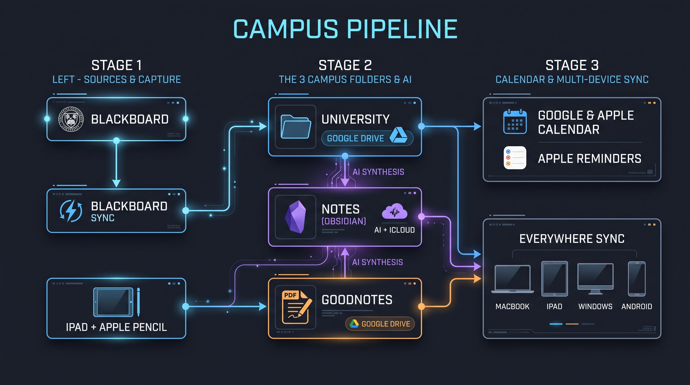

  

<h1 align="center">My Cave</h1>

  <em>"Built in a cave." — A personal engineering sanctuary and pipeline architecture built to live, learn, and ship with structure across every device.</em>

---

## 🎓 Campus

An end-to-end automated academic workflow built for Computer Engineering studies across **MacBook, iPad (Apple Pencil), Windows, and Android**:

  

- **`University/`** — Course slides, handouts, and assignments automatically mirrored from Blackboard via **[Blackboard Sync](https://github.com/UmutYLCN/blackboard-sync)** onto **Google Drive (5 TB Offline Mirror)**.
- **`Notes/`** — Structured **Obsidian** knowledge vault powered by AI note templates, custom CSS cards, formula sheets, and interactive inline SVG diagrams (`html-embed`), synced via **iCloud Drive ↔ Google Drive Mirror**.
- **`Goodnotes/`** — Handwritten Apple Pencil lecture notes and problem solutions on iPad, automatically backed up as PDFs to **Google Drive**.
- **Calendar & Tasks** — Deadlines and course schedules synced through **Google Calendar ↔ Apple Calendar**, paired with **Apple Reminders** for daily study execution.

---

  <strong>English</strong> | <a href="README.tr.md">Türkçe</a>

