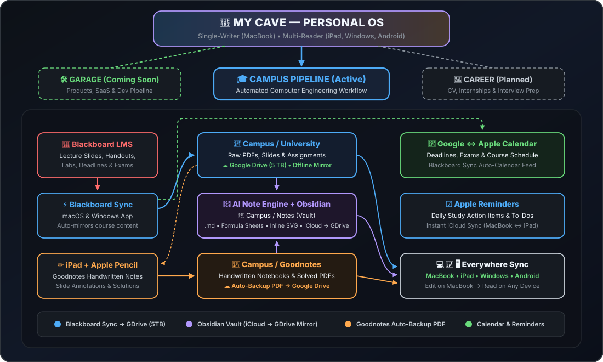

# 🦇 MyCave

My personal engineering and academic operating system — a unified workspace architecture connecting my studies, notes, and product development across all devices.

  

## 🎓 Campus (Active)

An automated academic pipeline built for Computer Engineering studies across **MacBook, iPad (Apple Pencil), Windows, and Android**:

- **`University/`** — Course slides, handouts, and assignments automatically mirrored from Blackboard via **[Blackboard Sync](https://github.com/UmutYLCN/blackboard-sync)** onto Google Drive (Offline Mirror).
- **`Notes/`** — Structured **Obsidian** knowledge vault powered by AI note templates, custom CSS cards, formula sheets, and interactive inline SVG diagrams (`html-embed`), synced via iCloud Drive & Google Drive mirror.
- **`Goodnotes/`** — Handwritten Apple Pencil lecture notes and problem solutions on iPad, automatically backed up as PDFs to Google Drive.
- **Calendar & Tasks** — Deadlines and course schedules synced through **Google Calendar ↔ Apple Calendar**, paired with **Apple Reminders** for daily study tasks.

## 🛠️ Garage (Coming Soon)

Product & software development pipeline for building and shipping personal projects.

## 🚀 Career (Planned)

Future pipeline for CV/resume versioning, internship & job tracking, and interview preparation.

---

  <strong>English</strong> | <a href="README.tr.md">Türkçe</a>

