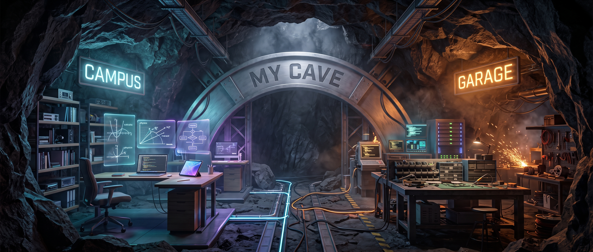
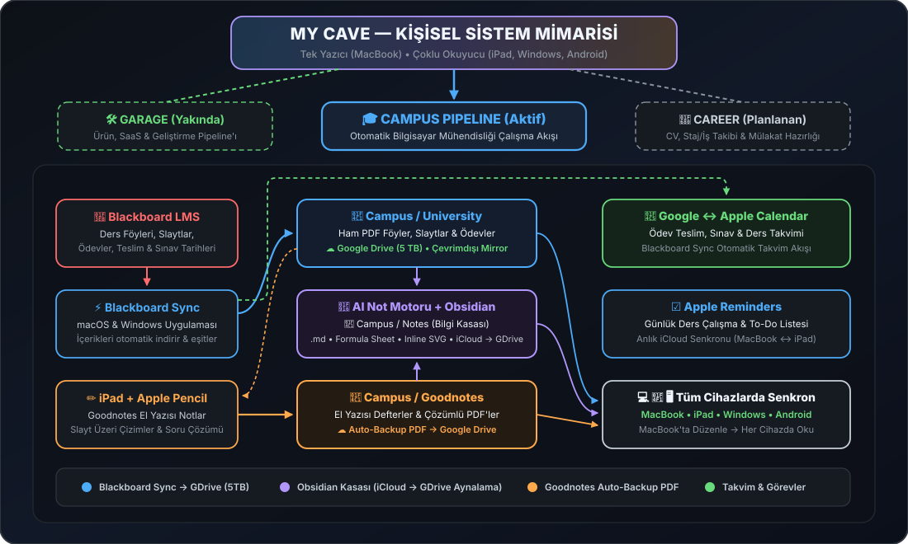

  

<h1 align="center">My Cave</h1>

  <em>"Bir mağarada sıfırdan inşa edildi." — Hayatımı, akademik derslerimi ve üretim süreçlerimi tüm cihazlarımda daha planlı ve disiplinli yönetmek için kurduğum kişisel mühendislik üssü ve pipeline mimarisi.</em>

---

## 🎓 Campus Pipeline (Aktif)

**MacBook, iPad (Apple Pencil), Windows ve Android** üzerinde Bilgisayar Mühendisliği eğitimi için kurulan uçtan uca otomatik akademik pipeline:

  

- **`University/`** — Blackboard üzerindeki ders föyleri, slaytlar ve ödevlerin **[Blackboard Sync](https://github.com/UmutYLCN/blackboard-sync)** ile otomatik olarak **Google Drive (5 TB Çevrimdışı Mirror)** üzerine indirilmesi.
- **`Notes/`** — AI ders notu şablonları, özel CSS kartları, formül tabloları (`Formula Sheet`) ve interaktif inline SVG diyagramlarıyla (`html-embed`) güçlendirilmiş **Obsidian** bilgi kasası (**iCloud Drive ↔ Google Drive Otomatik Aynalama**).
- **`Goodnotes/`** — iPad ve Apple Pencil ile alınan el yazısı ders notlarının ve soru çözümlerinin otomatik olarak PDF formatında **Google Drive**'a yedeklenmesi.
- **Takvim & Görevler** — Teslim tarihleri ve ders programının **Google Calendar ↔ Apple Calendar** üzerinden senkronizasyonu ve günlük çalışma görevleri için **Apple Reminders** entegrasyonu.

## 🛠️ Garage Pipeline (Yakında)

Üretim demirhanesi — öğrenilen mühendislik bilgisini ve fikirleri somut yazılım ürünlerine dönüştürmek ve yayınlamak için kurulan geliştirme pipeline'ı.

## 🚀 Career Pipeline (Planlanan)

CV/özgeçmiş versiyonlama, staj ve iş başvurusu takibi ile teknik mülakat hazırlık süreçleri için gelecekte kurulacak pipeline.

---

  <a href="README.md">English</a> | <strong>Türkçe</strong>

